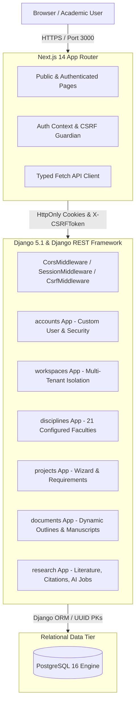

# ScholarForge AI — Technical Architecture (Stage 1)

## 1. System Architecture

## 2. Security & Session Model

ScholarForge enforces strict academic data privacy and credential protection:
1. **HttpOnly Cookie Authentication:** Sessions are governed by `scholarforge_sessionid` with `HttpOnly=True` and `SameSite=Lax`.
2. **Zero Storage of Credentials in Browser:** Neither passwords nor JWT access tokens are ever placed in `localStorage` or `sessionStorage`.
3. **Cross-Site Request Forgery (CSRF):** Mutating HTTP verbs (`POST`, `PUT`, `PATCH`, `DELETE`) require an active `X-CSRFToken` validated against `scholarforge_csrftoken`.
4. **Row-Level Ownership Isolation:** Evaluated via `IsProjectOwnerOrWorkspaceMember`. An authenticated user cannot retrieve, update, archive, or delete another user's research project (`403 Forbidden` / `404 Not Found`).

## 3. Multidisciplinary Domain Model

ScholarForge rejects rigid, one-size-fits-all document structures. It dynamically structures research outlines across:

- **3 Document Categories:**
  - `ACADEMIC_PROJECT` (Undergraduate, Capstone, Master's Thesis, PhD Dissertation)
  - `RESEARCH_PAPER` (Empirical, Conceptual, Theoretical, Systematic Review, Seminar Paper)
  - `JOURNAL_ARTICLE` (Original Research, Review Article, Short Communication)
- **21 Academic Disciplines:**
  - Computer Science, Information Technology, Management, Business Administration, Accounting, Economics, Finance, Engineering, Medicine, Nursing, Public Health, Education, Law, Political Science, Sociology, Psychology, Agriculture, Environmental Science, Arts, Humanities, Other.
- **6 Citation Standards:**
  - APA 7th edition, MLA 9th edition, Chicago 17th edition, Harvard, IEEE, Vancouver.
