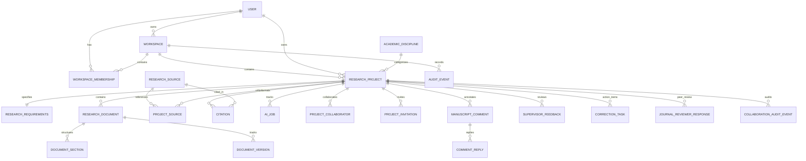

# ScholarForge AI — Database Schema & Data Dictionary

The platform uses PostgreSQL 16 with UUID primary keys and relational integrity across 54 domain models.

## Entity Relationship Overview

## Detailed Model Specifications

### 1. accounts.User
- `id` (UUID, Primary Key)
- `email` (EmailField, Unique, Indexed)
- `first_name` (CharField 150)
- `last_name` (CharField 150)
- `academic_level` (CharField 50: `UNDERGRADUATE`, `MASTERS`, `PHD`, `FACULTY`, `INDEPENDENT`)
- `institution` (CharField 255, optional)
- `orcid_id` (CharField 50, optional)
- `is_active` (BooleanField, default True)
- `is_staff` (BooleanField, default False)
- `date_joined` (DateTimeField)
- `updated_at` (DateTimeField)

### 2. workspaces.Workspace
- `id` (UUID, Primary Key)
- `name` (CharField 255)
- `slug` (SlugField 255)
- `owner_id` (ForeignKey -> User)
- `description` (TextField)
- `is_personal` (BooleanField, default True)
- `created_at`, `updated_at`

### 3. workspaces.WorkspaceMembership
- `id` (UUID, Primary Key)
- `workspace_id` (ForeignKey -> Workspace)
- `user_id` (ForeignKey -> User)
- `role` (CharField 50: `OWNER`, `ADMIN`, `COLLABORATOR`, `VIEWER`)
- UniqueConstraint: `[workspace, user]`

### 4. workspaces.AuditEvent
- `id` (UUID, Primary Key)
- `workspace_id` (ForeignKey -> Workspace, optional)
- `user_id` (ForeignKey -> User, optional)
- `action` (CharField 100)
- `entity_type` (CharField 100)
- `entity_id` (CharField 100)
- `details` (JSONField)
- `ip_address` (GenericIPAddressField)
- `created_at` (DateTimeField)

### 5. disciplines.AcademicDiscipline
- `id` (UUID, Primary Key)
- `name` (CharField 100, Unique, Indexed)
- `slug` (SlugField 120, Unique)
- `category` (CharField 100)
- `description` (TextField)
- `is_active` (BooleanField, default True)
- `created_at`, `updated_at`

### 6. projects.ResearchProject
- `id` (UUID, Primary Key)
- `workspace_id` (ForeignKey -> Workspace)
- `owner_id` (ForeignKey -> User)
- `discipline_id` (ForeignKey -> AcademicDiscipline)
- `title` (CharField 500)
- `document_category` (CharField 50: `ACADEMIC_PROJECT`, `RESEARCH_PAPER`, `JOURNAL_ARTICLE`)
- `document_subtype` (CharField 150)
- `academic_level` (CharField 50)
- `status` (CharField 50: `DRAFT`, `ACTIVE`, `ARCHIVED`)
- `institution` (CharField 255)
- `country` (CharField 100)
- `preferred_language` (CharField 50)
- `citation_style` (CharField 50: `APA`, `MLA`, `CHICAGO`, `HARVARD`, `IEEE`, `VANCOUVER`)
- `created_at`, `updated_at`

### 7. projects.ResearchRequirements
- `id` (UUID, Primary Key)
- `project_id` (OneToOneField -> ResearchProject)
- `research_methodology` (TextField)
- `research_objectives` (TextField)
- `supervisor_requirements` (TextField)
- `target_word_count` (PositiveIntegerField, optional)
- `deadline` (DateField, optional)
- `custom_parameters` (JSONField)
- `created_at`, `updated_at`

### 8. documents.ResearchDocument
- `id` (UUID, Primary Key)
- `project_id` (ForeignKey -> ResearchProject)
- `title` (CharField 500)
- `document_type` (CharField 100, default `MAIN_MANUSCRIPT`)
- `current_version_number` (PositiveIntegerField, default 1)
- `created_at`, `updated_at`

### 9. documents.DocumentSection
- `id` (UUID, Primary Key)
- `document_id` (ForeignKey -> ResearchDocument)
- `parent_section_id` (ForeignKey -> self, optional)
- `title` (CharField 255)
- `order_index` (PositiveIntegerField)
- `section_type` (CharField 100)
- `content` (TextField)
- `word_count` (PositiveIntegerField)
- `created_at`, `updated_at`

### 10. documents.DocumentVersion
- `id` (UUID, Primary Key)
- `document_id` (ForeignKey -> ResearchDocument)
- `version_number` (PositiveIntegerField)
- `snapshot_data` (JSONField)
- `created_by_id` (ForeignKey -> User)
- `change_summary` (TextField)
- `created_at` (DateTimeField)
- UniqueConstraint: `[document, version_number]`

### 11. research.ResearchSource
- `id` (UUID, Primary Key)
- `title` (CharField 500)
- `authors` (JSONField)
- `publication_year` (PositiveIntegerField, optional)
- `source_type` (CharField 50: `JOURNAL_ARTICLE`, `BOOK`, `BOOK_CHAPTER`, `CONFERENCE_PAPER`, `DISSERTATION`, `PREPRINT`, `WORKING_PAPER`, `LEGAL_DOCUMENT`, `REPORT`, `OTHER`)
- `journal_name` (CharField 500)
- `publisher` (CharField 500)
- `doi` (CharField 255)
- `url` (URLField 1000)
- `abstract` (TextField)
- `verification_status` (CharField 50: `METADATA_VERIFIED`, `PARTIALLY_VERIFIED`, `UNVERIFIED`, `METADATA_CONFLICT`, `WITHDRAWN_OR_RETRACTED`)
- `is_open_access` (BooleanField)
- `citation_count` (PositiveIntegerField)
- `provenance` (JSONField)
- `retracted` (BooleanField)
- `retraction_details` (TextField)
- `external_id` (CharField 255)
- `openalex_id` (CharField 255)
- `crossref_doi` (CharField 255)
- `semantic_scholar_id` (CharField 255)
- `reading_status` (CharField 20: `UNREAD`, `READING`, `READ`)
- `tags` (JSONField)
- `created_at`, `updated_at`

### 12. research.ProjectSource
- `id` (UUID, Primary Key)
- `project_id` (ForeignKey -> ResearchProject)
- `source_id` (ForeignKey -> ResearchSource)
- `notes` (TextField)
- `relevance_score` (PositiveIntegerField 1-10)
- `is_annotated` (BooleanField)
- `is_favorite` (BooleanField)
- `is_read` (BooleanField)
- `tags` (JSONField)
- `created_at`, `updated_at`
- UniqueConstraint: `[project, source]`

### 13. research.Citation
- `id` (UUID, Primary Key)
- `project_id` (ForeignKey -> ResearchProject)
- `source_id` (ForeignKey -> ResearchSource)
- `citation_style` (CharField 50: `APA_7TH`, `MLA_9TH`, `CHICAGO_17TH`, `HARVARD`, `IEEE`, `VANCOUVER`)
- `in_text_format` (CharField 500)
- `in_text_narrative` (CharField 500)
- `citation_number` (PositiveIntegerField, optional)
- `page_reference` (CharField 50, optional)
- `full_reference` (TextField)
- `created_at`, `updated_at`

### 14. research.AIJob (Active in Stage 2)
- `id` (UUID, Primary Key)
- `project_id` (ForeignKey -> ResearchProject)
- `user_id` (ForeignKey -> User)
- `job_type` (CharField 100: `GENERATE_SECTION`, `IMPROVE_WRITING`, `EXPAND_WRITING`, `SUMMARIZE_CONTENT`, `REWRITE_CONTENT`, `SUGGEST_OBJECTIVES`, `SUGGEST_QUESTIONS`, `SUGGEST_HYPOTHESES`, `SUGGEST_FRAMEWORK`, `SUGGEST_OUTLINE`)
- `status` (CharField 50: `PENDING`, `PROCESSING`, `COMPLETED`, `FAILED`)
- `input_payload` (JSONField)
- `output_payload` (JSONField)
- `error_message` (TextField)
- `created_at`, `updated_at`

### 15. research.ResearchCollection (Stage 3)
- `id` (UUID, Primary Key)
- `user_id` (ForeignKey -> User)
- `name` (CharField 255)
- `description` (TextField)
- `color_tag` (CharField 20)
- `created_at`, `updated_at`

### 16. research.ResearchCollectionItem (Stage 3)
- `id` (UUID, Primary Key)
- `collection_id` (ForeignKey -> ResearchCollection)
- `source_id` (ForeignKey -> ResearchSource)
- `notes` (TextField)
- `tags` (JSONField)
- `is_favorite` (BooleanField)
- `is_read` (BooleanField)
- `added_at` (DateTimeField)
- UniqueConstraint: `[collection, source]`

### 17. research.SourceVerification (Stage 3)
- `id` (UUID, Primary Key)
- `source_id` (ForeignKey -> ResearchSource)
- `verification_status` (CharField 50)
- `verification_source` (CharField 50: `CROSSREF`, `OPENALEX`, `SEMANTIC_SCHOLAR`, `MANUAL`)
- `similarity_scores` (JSONField)
- `retraction_detected` (BooleanField)
- `error_details` (TextField)
- `verified_at` (DateTimeField)

### 18. research.SourceDocument (Stage 3)
- `id` (UUID, Primary Key)
- `user_id` (ForeignKey -> User)
- `source_id` (ForeignKey -> ResearchSource, optional)
- `project_id` (ForeignKey -> ResearchProject, optional)
- `file` (FileField -> `uploads/documents/%Y/%m/`)
- `original_filename` (CharField 255)
- `file_type` (CharField 10: `PDF`, `DOCX`)
- `file_size_bytes` (PositiveBigIntegerField)
- `word_count` (PositiveIntegerField)
- `is_machine_readable` (BooleanField)
- `extraction_status` (CharField 20: `PENDING`, `COMPLETED`, `FAILED`, `UNSUPPORTED`)
- `extracted_text` (TextField)
- `created_at`, `updated_at`

### 19. research.SourceExcerpt (Stage 3)
- `id` (UUID, Primary Key)
- `document_id` (ForeignKey -> SourceDocument)
- `excerpt_text` (TextField)
- `page_number` (PositiveIntegerField)
- `tags` (JSONField)
- `created_at` (DateTimeField)

### 20. research.LiteratureExtraction (Stage 3)
- `id` (UUID, Primary Key)
- `source_id` (ForeignKey -> ResearchSource)
- `project_id` (ForeignKey -> ResearchProject)
- `objectives` (TextField)
- `methodology` (TextField)
- `findings` (TextField)
- `limitations` (TextField)
- `theoretical_framework` (TextField)
- `conceptual_framework` (TextField)
- `evidence_basis` (CharField 30: `FULL_TEXT`, `ABSTRACT`, `METADATA_ONLY`, `INSUFFICIENT`)
- `created_at`, `updated_at`

### 21. research.LiteratureReviewNote (Stage 3)
- `id` (UUID, Primary Key)
- `project_id` (ForeignKey -> ResearchProject)
- `user_id` (ForeignKey -> User)
- `review_type` (CharField 50: `CONCEPTUAL`, `THEORETICAL`, `EMPIRICAL`, `SYSTEMATIC`)
- `title` (CharField 255)
- `content` (JSONField / TextField)
- `sources` (ManyToManyField -> ResearchSource)
- `created_at`, `updated_at`

### 22. research.CitationAudit (Stage 3)
- `id` (UUID, Primary Key)
- `project_id` (ForeignKey -> ResearchProject)
- `run_by_id` (ForeignKey -> User)
- `integrity_score` (PositiveIntegerField: 0-100)
- `total_citations` (PositiveIntegerField)
- `in_text_count` (PositiveIntegerField)
- `bibliography_count` (PositiveIntegerField)
- `discrepancies_count` (PositiveIntegerField)
- `diagnostics` (JSONField)
- `created_at` (DateTimeField)

### 23. research.ResearchSearchJob (Stage 3)
- `id` (UUID, Primary Key)
- `user_id` (ForeignKey -> User)
- `query` (CharField 500)
- `discipline` (CharField 255)
- `publication_type` (CharField 50)
- `filters` (JSONField)
- `provider` (CharField 50)
- `results_count` (PositiveIntegerField)
- `created_at` (DateTimeField)

### 24. research.ResearchMethodology (Stage 4)
- `id` (UUID, Primary Key)
- `project_id` (ForeignKey -> ResearchProject)
- `methodology_type` (CharField 50: `QUANTITATIVE`, `QUALITATIVE`, `MIXED_METHODS`, `DISCIPLINE_SPECIFIC`)
- `design_category` (CharField 100)
- `design_name` (CharField 100)
- `epistemological_stance` (CharField 100)
- `justification` (TextField)
- `assumptions` (JSONField, list of strings)
- `limitations` (JSONField, list of strings)
- `target_population` (TextField)
- `sampling_strategy` (CharField 100)
- `sample_size` (PositiveIntegerField)
- `unit_of_analysis` (CharField 100)
- `approved_by_researcher` (BooleanField, default False)
- `approved_at` (DateTimeField, optional)
- `created_at`, `updated_at`

### 25. research.ResearchVariable (Stage 4)
- `id` (UUID, Primary Key)
- `project_id` (ForeignKey -> ResearchProject)
- `name` (CharField 255)
- `variable_role` (CharField 50: `INDEPENDENT`, `DEPENDENT`, `MEDIATING`, `MODERATING`, `CONTROL`)
- `variable_type` (CharField 50: `NOMINAL`, `ORDINAL`, `INTERVAL`, `RATIO`)
- `operational_definition` (TextField)
- `conceptual_definition` (TextField)
- `created_at`, `updated_at`

### 26. research.ResearchInstrument (Stage 4)
- `id` (UUID, Primary Key)
- `project_id` (ForeignKey -> ResearchProject)
- `title` (CharField 255)
- `instrument_type` (CharField 50: `QUESTIONNAIRE`, `INTERVIEW_GUIDE`, `OBSERVATION_CHECKLIST`, `TEST`)
- `instructions` (TextField)
- `is_validated` (BooleanField, default False)
- `created_at`, `updated_at`

### 27. research.InstrumentItem (Stage 4)
- `id` (UUID, Primary Key)
- `instrument_id` (ForeignKey -> ResearchInstrument)
- `order_index` (PositiveIntegerField)
- `item_text` (TextField)
- `construct_name` (CharField 255)
- `item_type` (CharField 50: `LIKERT_5`, `LIKERT_7`, `MULTIPLE_CHOICE`, `OPEN_ENDED`, `DEMOGRAPHIC`)
- `is_reverse_coded` (BooleanField, default False)
- `polarity` (CharField 20: `POSITIVE`, `NEGATIVE`)
- `created_at`, `updated_at`

### 28. research.ResearchDataset (Stage 4)
- `id` (UUID, Primary Key)
- `project_id` (ForeignKey -> ResearchProject)
- `name` (CharField 255)
- `file_format` (CharField 20: `CSV`, `XLSX`, `JSON`)
- `file_size_bytes` (BigIntegerField, capped at 20MB)
- `row_count` (PositiveIntegerField)
- `column_count` (PositiveIntegerField)
- `has_formula_sanitized` (BooleanField, default False)
- `current_version_number` (PositiveIntegerField, default 1)
- `columns_schema` (JSONField)
- `created_at`, `updated_at`

### 29. research.DatasetVersion (Stage 4)
- `id` (UUID, Primary Key)
- `dataset_id` (ForeignKey -> ResearchDataset)
- `version_number` (PositiveIntegerField)
- `transformation_applied` (CharField 255)
- `summary_statistics` (JSONField)
- `created_at` (DateTimeField)

### 30. research.AnalysisJob (Stage 4)
- `id` (UUID, Primary Key)
- `project_id` (ForeignKey -> ResearchProject)
- `status` (CharField: `PENDING`, `RUNNING`, `COMPLETED`, `FAILED`)
- `created_at`, `updated_at`

### 31. research.StatisticalResult (Stage 4)
- `id` (UUID, Primary Key)
- `job_id` (OneToOneField -> AnalysisJob)
- `project_id` (ForeignKey -> ResearchProject)
- `analysis_type` (CharField 100)
- `sample_size` (PositiveIntegerField)
- `metrics` (JSONField)
- `p_values` (JSONField)
- `effect_sizes` (JSONField)
- `apa_format_string` (CharField 500)
- `apa_summary` (TextField)
- `apa_table_html` (TextField)
- `created_at` (DateTimeField)

### 32. research.HypothesisTest (Stage 4)
- `id` (UUID, Primary Key)
- `project_id` (ForeignKey -> ResearchProject)
- `hypothesis_statement` (TextField)
- `test_type` (CharField 100)
- `decision` (CharField 50: `REJECT_NULL`, `FAIL_TO_REJECT_NULL`, `INCONCLUSIVE`)
- `test_statistic_value` (FloatField)
- `p_value` (FloatField)
- `effect_size_value` (FloatField, optional)
- `apa_format_string` (CharField 500)
- `substantive_interpretation` (TextField)
- `evaluated_at` (DateTimeField)

### 33. research.QualitativeTranscript (Stage 4)
- `id` (UUID, Primary Key)
- `project_id` (ForeignKey -> ResearchProject)
- `title` (CharField 255)
- `participant_identifier` (CharField 100)
- `transcript_type` (CharField 50: `INTERVIEW`, `FOCUS_GROUP`, `OBSERVATION`, `ARCHIVAL`)
- `content` (TextField)
- `word_count` (PositiveIntegerField)
- `created_at`, `updated_at`

### 34. research.QualitativeCode (Stage 4)
- `id` (UUID, Primary Key)
- `project_id` (ForeignKey -> ResearchProject)
- `name` (CharField 255)
- `description` (TextField, optional)
- `color` (CharField 50)
- `excerpt_count` (PositiveIntegerField, default 0)
- `created_at`, `updated_at`

### 35. research.EvidenceExcerpt (Stage 4)
- `id` (UUID, Primary Key)
- `transcript_id` (ForeignKey -> QualitativeTranscript)
- `code_id` (ForeignKey -> QualitativeCode)
- `start_char` (PositiveIntegerField)
- `end_char` (PositiveIntegerField)
- `quote_text` (TextField, cryptographically validated)
- `researcher_memo` (TextField, optional)
- `is_verified_verbatim` (BooleanField, default True)
- `created_at` (DateTimeField)

### 36. research.QualitativeTheme (Stage 4)
- `id` (UUID, Primary Key)
- `project_id` (ForeignKey -> ResearchProject)
- `title` (CharField 255)
- `description` (TextField)
- `summary_narrative` (TextField)
- `created_at`, `updated_at`

### 37. research.ResearchVisualization (Stage 4)
- `id` (UUID, Primary Key)
- `project_id` (ForeignKey -> ResearchProject)
- `title` (CharField 255)
- `visualization_type` (CharField 50: `BAR_CHART`, `LINE_CHART`, `SCATTER_PLOT`, `BOX_PLOT`)
- `config` (JSONField)
- `created_at` (DateTimeField)

---

## Stage 5 Models: Research Workflow, Assembly & Quality Assurance

### 38. research.ResearchWorkflowStage (Stage 5)
- `id` (UUID, Primary Key)
- `project_id` (ForeignKey -> ResearchProject)
- `title` (CharField 120)
- `category` (CharField 50)
- `order` (IntegerField)
- `status` (CharField 30: `NOT_STARTED`, `IN_PROGRESS`, `BLOCKED`, `COMPLETED`)
- `progress_percentage` (FloatField default 0.0)
- `is_mandatory` (BooleanField default True)
- `created_at`, `updated_at` (DateTimeField)

### 39. research.ResearchWorkflowStep (Stage 5)
- `id` (UUID, Primary Key)
- `stage_id` (ForeignKey -> ResearchWorkflowStage)
- `title` (CharField 255)
- `description` (TextField)
- `order` (IntegerField)
- `is_completed` (BooleanField default False)
- `completed_at` (DateTimeField null=True)
- `verification_entity_type` (CharField 60)

### 40. research.ResearchDecision (Stage 5)
- `id` (UUID, Primary Key)
- `project_id` (OneToOneField -> ResearchProject)
- `title_confirmed` (BooleanField default False)
- `problem_statement` (TextField)
- `research_aim` (TextField)
- `objectives` (JSONField default list)
- `research_questions` (JSONField default list)
- `hypotheses` (JSONField default list)
- `variables_and_constructs` (JSONField default list)
- `conceptual_relationships` (JSONField default list)
- `scope_and_delimitation` (TextField)
- `limitations` (TextField)
- `proposed_methodology` (TextField)
- `is_approved` (BooleanField default False)
- `approved_by` (ForeignKey -> User null=True)
- `approved_at` (DateTimeField null=True)
- `audit_trail` (JSONField default list)
- `created_at`, `updated_at` (DateTimeField)

### 41. research.ResearchAlignmentMatrix (Stage 5)
- `id` (UUID, Primary Key)
- `project_id` (OneToOneField -> ResearchProject)
- `congruence_index` (IntegerField default 100)
- `overall_status` (CharField 30: `ALIGNED`, `NEEDS_ATTENTION`, `MISALIGNED`)
- `matrix_data` (JSONField default dict)
- `last_evaluated_at` (DateTimeField)
- `created_at` (DateTimeField)

### 42. research.AlignmentIssue (Stage 5)
- `id` (UUID, Primary Key)
- `matrix_id` (ForeignKey -> ResearchAlignmentMatrix)
- `source_node` (CharField 50)
- `target_node` (CharField 50)
- `severity` (CharField 20: `CRITICAL`, `WARNING`, `SUGGESTION`)
- `title` (CharField 255)
- `description` (TextField)
- `recommendation` (TextField)
- `is_resolved` (BooleanField default False)
- `created_at` (DateTimeField)

### 43. research.ManuscriptAssembly (Stage 5)
- `id` (UUID, Primary Key)
- `project_id` (ForeignKey -> ResearchProject)
- `assembled_by` (ForeignKey -> User)
- `document_title` (CharField 255)
- `citation_style` (CharField 50 default 'APA 7th')
- `include_preliminary_pages` (BooleanField default True)
- `include_table_of_contents` (BooleanField default True)
- `include_list_of_tables` (BooleanField default True)
- `include_list_of_figures` (BooleanField default True)
- `include_references` (BooleanField default True)
- `include_appendices` (BooleanField default True)
- `total_word_count` (IntegerField default 0)
- `total_tables_count` (IntegerField default 0)
- `total_figures_count` (IntegerField default 0)
- `total_citations_count` (IntegerField default 0)
- `compiled_html` (TextField)
- `structure_manifest` (JSONField default dict)
- `created_at` (DateTimeField)

### 44. research.ManuscriptValidation (Stage 5)
- `id` (UUID, Primary Key)
- `project_id` (ForeignKey -> ResearchProject)
- `overall_score` (IntegerField default 0)
- `is_ready_for_review` (BooleanField default False)
- `category_scores` (JSONField default dict)
- `academic_disclaimer` (TextField)
- `created_at` (DateTimeField)

### 45. research.ValidationIssue (Stage 5)
- `id` (UUID, Primary Key)
- `validation_id` (ForeignKey -> ManuscriptValidation)
- `category` (CharField 40: `STRUCTURAL_QUALITY`, `RESEARCH_CONSISTENCY`, `CITATION_INTEGRITY`, `EVIDENCE_VALIDITY`, `WRITING_QUALITY`, `MANUSCRIPT_COMPLETENESS`)
- `severity` (CharField 20: `CRITICAL`, `WARNING`, `SUGGESTION`)
- `section_name` (CharField 255 blank=True)
- `message` (TextField)
- `suggestion` (TextField)
- `created_at` (DateTimeField)

### 46. research.ReviewRecord (Stage 5)
- `id` (UUID, Primary Key)
- `project_id` (ForeignKey -> ResearchProject)
- `reviewer` (ForeignKey -> User)
- `status` (CharField 40: `DRAFT`, `READY_FOR_INTERNAL_REVIEW`, `REVISIONS_REQUIRED`, `APPROVED_DRAFT`)
- `comments` (TextField)
- `review_checklist` (JSONField default dict)
- `action_items` (JSONField default list)
- `created_at`, `updated_at` (DateTimeField)

---

## Stage 6 Models: Supervisor Review, Collaboration & Revision Lifecycles

### 47. research.ProjectCollaborator (Stage 6)
- `id` (UUID, Primary Key)
- `project_id` (ForeignKey -> ResearchProject)
- `user_id` (ForeignKey -> User)
- `role` (CharField 30: `PROJECT_OWNER`, `SUPERVISOR`, `CO_AUTHOR`, `ACADEMIC_REVIEWER`, `VIEWER`)
- `invited_by_id` (ForeignKey -> User nullable)
- `assigned_sections` (JSONField default list)
- `can_edit_manuscript` (BooleanField default False)
- `can_approve_revisions` (BooleanField default False)
- `can_view_data` (BooleanField default True)
- `created_at`, `updated_at` (DateTimeField)
- Constraint: `unique_together = ('project', 'user')`

### 48. research.ProjectInvitation (Stage 6)
- `id` (UUID, Primary Key)
- `project_id` (ForeignKey -> ResearchProject)
- `email` (EmailField)
- `role` (CharField 30)
- `token` (CharField 128 unique)
- `invited_by_id` (ForeignKey -> User)
- `assigned_sections` (JSONField default list)
- `status` (CharField 20: `PENDING`, `ACCEPTED`, `REJECTED`, `REVOKED`, `EXPIRED`)
- `created_at` (DateTimeField)
- `expires_at` (DateTimeField default now + 7 days)

### 49. research.ManuscriptComment (Stage 6)
- `id` (UUID, Primary Key)
- `project_id` (ForeignKey -> ResearchProject)
- `document_id` (ForeignKey -> ResearchDocument)
- `section_id` (ForeignKey -> DocumentSection nullable)
- `author_id` (ForeignKey -> User)
- `content` (TextField)
- `start_offset` (PositiveIntegerField nullable)
- `end_offset` (PositiveIntegerField nullable)
- `anchor_text` (TextField blank=True)
- `anchor_prefix` (TextField blank=True)
- `anchor_suffix` (TextField blank=True)
- `status` (CharField 20: `OPEN`, `RESOLVED`, `ORPHANED`)
- `created_at`, `updated_at` (DateTimeField)

### 50. research.CommentReply (Stage 6)
- `id` (UUID, Primary Key)
- `comment_id` (ForeignKey -> ManuscriptComment)
- `author_id` (ForeignKey -> User)
- `content` (TextField)
- `created_at`, `updated_at` (DateTimeField)

### 51. research.SupervisorFeedback (Stage 6)
- `id` (UUID, Primary Key)
- `project_id` (ForeignKey -> ResearchProject)
- `uploaded_by_id` (ForeignKey -> User)
- `title` (CharField 255 blank=True)
- `source_type` (CharField 30: `MANUAL_ENTRY`, `DOCX_UPLOAD`, `PDF_UPLOAD`, `INLINE_THREAD_IMPORT`)
- `raw_content` (TextField blank=True)
- `file_attachment` (FileField upload_to='supervisor_feedback/')
- `extracted_comments` (JSONField default list)
- `has_unextracted_annotations` (BooleanField default False)
- `created_at` (DateTimeField)

### 52. research.CorrectionTask (Stage 6)
- `id` (UUID, Primary Key)
- `project_id` (ForeignKey -> ResearchProject)
- `feedback_source_id` (ForeignKey -> SupervisorFeedback nullable)
- `section_id` (ForeignKey -> DocumentSection nullable)
- `category` (CharField 50 across 15 categories)
- `priority` (CharField 20: `CRITICAL`, `HIGH`, `MEDIUM`, `LOW`)
- `status` (CharField 30: `OPEN`, `IN_PROGRESS`, `PROPOSED`, `READY_FOR_REVIEW`, `APPROVED`, `REJECTED`, `RESOLVED`, `REOPENED`)
- `title` (CharField 255 blank=True)
- `instruction` (TextField blank=True)
- `original_text` (TextField blank=True)
- `proposed_text` (TextField blank=True)
- `expected_base_version` (IntegerField default 1)
- `is_stale_after_subsequent_edit` (BooleanField default False)
- `approved_by_id` (ForeignKey -> User nullable)
- `approved_at` (DateTimeField nullable)
- `created_at`, `updated_at` (DateTimeField)

### 53. research.JournalReviewerResponse (Stage 6)
- `id` (UUID, Primary Key)
- `project_id` (ForeignKey -> ResearchProject)
- `reviewer_label` (CharField 50)
- `comment_number` (PositiveIntegerField)
- `original_comment` (TextField)
- `revision_category` (CharField 30: `MAJOR`, `MINOR`, `CLARIFICATION`, `REJECT_REQUEST`)
- `linked_task_id` (ForeignKey -> CorrectionTask nullable)
- `target_section_id` (ForeignKey -> DocumentSection nullable)
- `author_response` (TextField blank=True)
- `is_verified_applied` (BooleanField default False)
- `created_at`, `updated_at` (DateTimeField)
- Constraint: `unique_together = ('project', 'reviewer_label', 'comment_number')`

### 54. research.CollaborationAuditEvent (Stage 6)
- `id` (UUID, Primary Key)
- `project_id` (ForeignKey -> ResearchProject)
- `actor_id` (ForeignKey -> User nullable)
- `event_type` (CharField 100)
- `details` (JSONField default dict)
- `created_at` (DateTimeField)

## Stage 7 Models: University Academic Formatting, Institutional Templates & Compliance Intelligence

### 55. research.AcademicInstitution (Stage 7)
- `id` (UUID, Primary Key)
- `name` (CharField 255 unique)
- `country` (CharField 100)
- `city` (CharField 100 blank=True)
- `code` (CharField 50 blank=True)
- `website` (URLField blank=True)
- `is_verified` (BooleanField default False)
- `verification_source` (CharField 255 blank=True)
- `created_at`, `updated_at` (DateTimeField)

### 56. research.AcademicFaculty (Stage 7)
- `id` (UUID, Primary Key)
- `institution` (ForeignKey -> AcademicInstitution)
- `name` (CharField 255)
- `code` (CharField 50 blank=True)
- `created_at` (DateTimeField)
- Constraint: `unique_together = ('institution', 'name')`

### 57. research.AcademicDepartment (Stage 7)
- `id` (UUID, Primary Key)
- `faculty` (ForeignKey -> AcademicFaculty nullable)
- `name` (CharField 255)
- `code` (CharField 50 blank=True)
- `created_at` (DateTimeField)

### 58. research.FormattingTemplate (Stage 7)
- `id` (UUID, Primary Key)
- `name` (CharField 255)
- `description` (TextField blank=True)
- `template_type` (CharField 30: `INSTITUTIONAL`, `JOURNAL`, `STANDARD`)
- `institution` (ForeignKey -> AcademicInstitution nullable)
- `faculty` (ForeignKey -> AcademicFaculty nullable)
- `department` (ForeignKey -> AcademicDepartment nullable)
- `degree_level` (CharField 30: `UNDERGRADUATE`, `MASTERS`, `PHD`, `POSTDOC`, `FACULTY`)
- `document_type` (CharField 30: `THESIS`, `DISSERTATION`, `RESEARCH_PROJECT`, `RESEARCH_PAPER`, `JOURNAL_ARTICLE`, `SEMINAR_PAPER`, `CONFERENCE_PAPER`, `GENERAL`)
- `citation_style` (CharField 50 default='apa-7th')
- `verification_status` (CharField 30: `OFFICIALLY_VERIFIED`, `COMMUNITY_VERIFIED`, `USER_CUSTOMIZED`, `DRAFT`, `ARCHIVED`)
- `verification_source_url` (URLField blank=True)
- `verification_notes` (TextField blank=True)
- `verification_date` (DateTimeField nullable)
- `verified_by` (ForeignKey -> User nullable)
- `is_default` (BooleanField default False)
- `is_shared` (BooleanField default True)
- `created_by` (ForeignKey -> User nullable)
- `created_at`, `updated_at` (DateTimeField)

### 59. research.TemplateVersion (Stage 7)
- `id` (UUID, Primary Key)
- `template` (ForeignKey -> FormattingTemplate)
- `version_number` (PositiveIntegerField default 1)
- `rules_config` (JSONField default dict across 8 categories)
- `changelog` (TextField blank=True)
- `is_active` (BooleanField default True)
- `created_by` (ForeignKey -> User nullable)
- `created_at` (DateTimeField)
- Constraint: `unique_together = ('template', 'version_number')`

### 60. research.TemplateGuidelineSource (Stage 7)
- `id` (UUID, Primary Key)
- `template` (ForeignKey -> FormattingTemplate nullable)
- `institution` (ForeignKey -> AcademicInstitution nullable)
- `file_attachment` (FileField upload_to='guidelines/')
- `raw_text` (TextField blank=True)
- `extracted_rules` (JSONField default list)
- `parsing_confidence` (FloatField default 0.0)
- `status` (CharField 30: `PENDING_REVIEW`, `APPROVED`, `REJECTED`)
- `uploaded_by` (ForeignKey -> User nullable)
- `created_at` (DateTimeField)

### 61. research.JournalProfile (Stage 7)
- `id` (UUID, Primary Key)
- `name` (CharField 255)
- `publisher` (CharField 255)
- `issn_print` (CharField 30 blank=True)
- `issn_electronic` (CharField 30 blank=True)
- `aims_and_scope` (TextField blank=True)
- `submission_url` (URLField blank=True)
- `author_guidelines_url` (URLField blank=True)
- `article_type` (CharField 40: `ORIGINAL_RESEARCH`, `REVIEW_ARTICLE`, `SYSTEMATIC_REVIEW`, `CONCEPTUAL_THEORETICAL`)
- `word_limit` (PositiveIntegerField nullable)
- `abstract_word_limit` (PositiveIntegerField nullable)
- `keywords_limit` (PositiveIntegerField default 6)
- `reference_limit` (PositiveIntegerField nullable)
- `double_blind_review` (BooleanField default False)
- `requires_highlights` (BooleanField default False)
- `ethics_statement_required` (BooleanField default True)
- `conflict_of_interest_required` (BooleanField default True)
- `data_availability_required` (BooleanField default True)
- `funding_statement_required` (BooleanField default True)
- `citation_style` (CharField 50 default='apa-7th')
- `verification_status` (CharField 30)
- `created_at` (DateTimeField)

### 62. research.ManuscriptMetadata (Stage 7)
- `id` (UUID, Primary Key)
- `project` (OneToOneField -> ResearchProject)
- `corresponding_author_name` (CharField 255 blank=True)
- `corresponding_author_email` (EmailField blank=True)
- `corresponding_author_phone` (CharField 50 blank=True)
- `affiliations` (JSONField default list)
- `orcid_identifiers` (JSONField default list)
- `conflict_of_interest_statement` (TextField blank=True)
- `data_availability_statement` (TextField blank=True)
- `ethics_approval_statement` (TextField blank=True)
- `funding_grant_details` (TextField blank=True)
- `acknowledgements_text` (TextField blank=True)
- `submission_readiness_score` (PositiveIntegerField default 0)
- `created_at`, `updated_at` (DateTimeField)

### 63. research.ProjectTemplateAssignment (Stage 7)
- `id` (UUID, Primary Key)
- `project` (OneToOneField -> ResearchProject)
- `template` (ForeignKey -> FormattingTemplate)
- `template_version` (ForeignKey -> TemplateVersion nullable)
- `assigned_by` (ForeignKey -> User nullable)
- `assigned_at` (DateTimeField)

### 64. research.FormattingValidation (Stage 7)
- `id` (UUID, Primary Key)
- `project` (ForeignKey -> ResearchProject)
- `template_version` (ForeignKey -> TemplateVersion nullable)
- `audited_by` (ForeignKey -> User nullable)
- `total_issues` (PositiveIntegerField default 0)
- `critical_count` (PositiveIntegerField default 0)
- `major_count` (PositiveIntegerField default 0)
- `minor_count` (PositiveIntegerField default 0)
- `info_count` (PositiveIntegerField default 0)
- `overall_status` (CharField 30: `COMPLIANT`, `NEEDS_CORRECTION`, `NON_COMPLIANT`)
- `layout_verified` (BooleanField default False)
- `audited_at` (DateTimeField)

### 65. research.FormattingIssue (Stage 7)
- `id` (UUID, Primary Key)
- `validation` (ForeignKey -> FormattingValidation)
- `rule_key` (CharField 100)
- `rule_category` (CharField 50 across 9 categories)
- `severity` (CharField 20: `CRITICAL`, `MAJOR`, `MINOR`, `INFORMATIONAL`)
- `current_value` (TextField blank=True)
- `expected_value` (TextField blank=True)
- `location` (CharField 255 blank=True)
- `suggested_fix` (TextField blank=True)
- `fix_available` (BooleanField default False)
- `resolved_at` (DateTimeField nullable)
- `is_resolved` (BooleanField default False)

### 66. research.FormattingChange (Stage 7)
- `id` (UUID, Primary Key)
- `validation` (ForeignKey -> FormattingValidation nullable)
- `section` (ForeignKey -> DocumentSection)
- `rule_key` (CharField 100)
- `field_modified` (CharField 50)
- `previous_value` (TextField)
- `new_value` (TextField)
- `is_reverted` (BooleanField default False)
- `created_at` (DateTimeField)

---

## Stage 8 Models: Professional Word & PDF Export, Pagination & QA

### 67. research.DocumentExport (Stage 8)
- `id` (UUID, Primary Key)
- `project` (ForeignKey -> ResearchProject)
- `document_version` (ForeignKey -> DocumentVersion nullable)
- `export_format` (CharField 10: `DOCX`, `PDF`)
- `template_version` (ForeignKey -> TemplateVersion nullable)
- `citation_style` (CharField 50)
- `file_artifact` (FileField upload_to='private/exports/')
- `file_name` (CharField 255)
- `file_checksum` (CharField 64, SHA-256)
- `file_size_bytes` (PositiveIntegerField)
- `page_count` (PositiveIntegerField default 1)
- `heading_count` (PositiveIntegerField default 0)
- `table_count` (PositiveIntegerField default 0)
- `figure_count` (PositiveIntegerField default 0)
- `reference_count` (PositiveIntegerField default 0)
- `word_count` (PositiveIntegerField default 0)
- `metadata_snapshot` (JSONField default dict)
- `is_verified` (BooleanField default True)
- `created_by` (ForeignKey -> User nullable)
- `created_at`, `updated_at` (DateTimeField)

### 68. research.ExportJob (Stage 8)
- `id` (UUID, Primary Key)
- `project` (ForeignKey -> ResearchProject)
- `export_format` (CharField 10: `DOCX`, `PDF`)
- `template` (ForeignKey -> FormattingTemplate nullable)
- `status` (CharField 20: `PENDING`, `PROCESSING`, `VALIDATING`, `COMPLETED`, `FAILED`)
- `progress_pct` (PositiveIntegerField default 0)
- `status_message` (CharField 255)
- `error_message` (TextField blank=True)
- `idempotency_key` (CharField 128 unique)
- `document_export` (ForeignKey -> DocumentExport nullable)
- `export_options` (JSONField default dict)
- `created_by` (ForeignKey -> User nullable)
- `created_at`, `updated_at` (DateTimeField)

### 69. research.ExportValidation (Stage 8)
- `id` (UUID, Primary Key)
- `document_export` (OneToOneField -> DocumentExport)
- `structure_valid` (BooleanField default True)
- `layout_valid` (BooleanField default True)
- `citations_valid` (BooleanField default True)
- `total_issues` (PositiveIntegerField default 0)
- `overall_rating` (CharField 20: `EXCELLENT`, `ACCEPTABLE`, `NEEDS_ATTENTION`, `FAILED`)
- `summary_notes` (TextField blank=True)
- `cross_check_diffs` (JSONField default dict)
- `metrics` (JSONField default dict)
- `created_at` (DateTimeField)

### 70. research.ExportIssue (Stage 8)
- `id` (UUID, Primary Key)
- `validation` (ForeignKey -> ExportValidation)
- `category` (CharField 20: `STRUCTURE`, `LAYOUT`, `CONTENT`, `INTEGRITY`)
- `severity` (CharField 20: `CRITICAL`, `MAJOR`, `MINOR`, `INFORMATIONAL`, `NOT_VERIFIED`)
- `message` (TextField)
- `page_number` (PositiveIntegerField nullable)
- `location` (CharField 255 blank=True)
- `suggested_action` (TextField blank=True)
- `created_at` (DateTimeField)

### 71. research.RenderedAsset (Stage 8)
- `id` (UUID, Primary Key)
- `document_export` (ForeignKey -> DocumentExport)
- `page_number` (PositiveIntegerField)
- `asset_type` (CharField 30: `PAGE_THUMBNAIL`, `SVG_PREVIEW`, `CANVAS_JSON`)
- `image_file` (FileField upload_to='private/previews/' blank=True)
- `image_data_uri` (TextField blank=True)
- `created_at` (DateTimeField)

