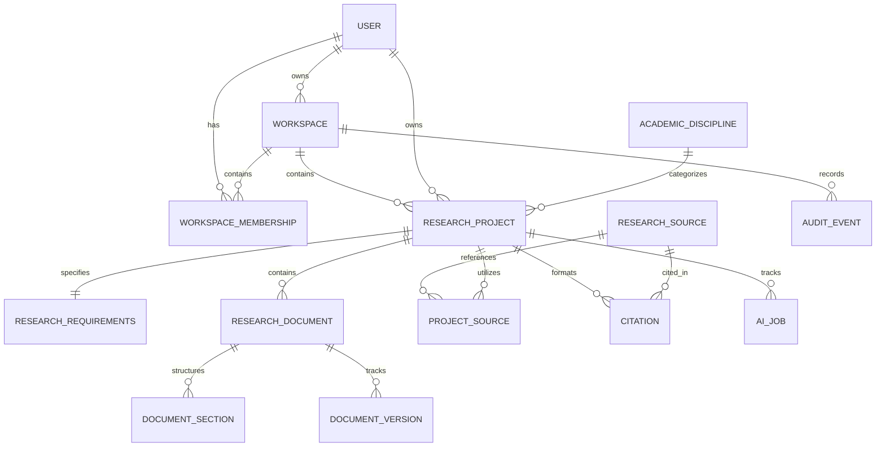

# ScholarForge AI — Database Schema & Data Dictionary

The platform uses PostgreSQL 16 with UUID primary keys and relational integrity across 14 domain models.

## Entity Relationship Overview

## Detailed Model Specifications

### 1. accounts.User
- `id` (UUID, Primary Key)
- `email` (EmailField, Unique, Indexed)
- `first_name` (CharField 150)
- `last_name` (CharField 150)
- `academic_level` (CharField 50: `UNDERGRADUATE`, `MASTERS`, `PHD`, `FACULTY`, `INDEPENDENT`)
- `institution` (CharField 255, optional)
- `orcid_id` (CharField 50, optional)
- `is_active` (BooleanField, default True)
- `is_staff` (BooleanField, default False)
- `date_joined` (DateTimeField)
- `updated_at` (DateTimeField)

### 2. workspaces.Workspace
- `id` (UUID, Primary Key)
- `name` (CharField 255)
- `slug` (SlugField 255)
- `owner_id` (ForeignKey -> User)
- `description` (TextField)
- `is_personal` (BooleanField, default True)
- `created_at`, `updated_at`

### 3. workspaces.WorkspaceMembership
- `id` (UUID, Primary Key)
- `workspace_id` (ForeignKey -> Workspace)
- `user_id` (ForeignKey -> User)
- `role` (CharField 50: `OWNER`, `ADMIN`, `COLLABORATOR`, `VIEWER`)
- UniqueConstraint: `[workspace, user]`

### 4. workspaces.AuditEvent
- `id` (UUID, Primary Key)
- `workspace_id` (ForeignKey -> Workspace, optional)
- `user_id` (ForeignKey -> User, optional)
- `action` (CharField 100)
- `entity_type` (CharField 100)
- `entity_id` (CharField 100)
- `details` (JSONField)
- `ip_address` (GenericIPAddressField)
- `created_at` (DateTimeField)

### 5. disciplines.AcademicDiscipline
- `id` (UUID, Primary Key)
- `name` (CharField 100, Unique, Indexed)
- `slug` (SlugField 120, Unique)
- `category` (CharField 100)
- `description` (TextField)
- `is_active` (BooleanField, default True)
- `created_at`, `updated_at`

### 6. projects.ResearchProject
- `id` (UUID, Primary Key)
- `workspace_id` (ForeignKey -> Workspace)
- `owner_id` (ForeignKey -> User)
- `discipline_id` (ForeignKey -> AcademicDiscipline)
- `title` (CharField 500)
- `document_category` (CharField 50: `ACADEMIC_PROJECT`, `RESEARCH_PAPER`, `JOURNAL_ARTICLE`)
- `document_subtype` (CharField 150)
- `academic_level` (CharField 50)
- `status` (CharField 50: `DRAFT`, `ACTIVE`, `ARCHIVED`)
- `institution` (CharField 255)
- `country` (CharField 100)
- `preferred_language` (CharField 50)
- `citation_style` (CharField 50: `APA`, `MLA`, `CHICAGO`, `HARVARD`, `IEEE`, `VANCOUVER`)
- `created_at`, `updated_at`

### 7. projects.ResearchRequirements
- `id` (UUID, Primary Key)
- `project_id` (OneToOneField -> ResearchProject)
- `research_methodology` (TextField)
- `research_objectives` (TextField)
- `supervisor_requirements` (TextField)
- `target_word_count` (PositiveIntegerField, optional)
- `deadline` (DateField, optional)
- `custom_parameters` (JSONField)
- `created_at`, `updated_at`

### 8. documents.ResearchDocument
- `id` (UUID, Primary Key)
- `project_id` (ForeignKey -> ResearchProject)
- `title` (CharField 500)
- `document_type` (CharField 100, default `MAIN_MANUSCRIPT`)
- `current_version_number` (PositiveIntegerField, default 1)
- `created_at`, `updated_at`

### 9. documents.DocumentSection
- `id` (UUID, Primary Key)
- `document_id` (ForeignKey -> ResearchDocument)
- `parent_section_id` (ForeignKey -> self, optional)
- `title` (CharField 255)
- `order_index` (PositiveIntegerField)
- `section_type` (CharField 100)
- `content` (TextField)
- `word_count` (PositiveIntegerField)
- `created_at`, `updated_at`

### 10. documents.DocumentVersion
- `id` (UUID, Primary Key)
- `document_id` (ForeignKey -> ResearchDocument)
- `version_number` (PositiveIntegerField)
- `snapshot_data` (JSONField)
- `created_by_id` (ForeignKey -> User)
- `change_summary` (TextField)
- `created_at` (DateTimeField)
- UniqueConstraint: `[document, version_number]`

### 11. research.ResearchSource
- `id` (UUID, Primary Key)
- `title` (CharField 500)
- `authors` (JSONField)
- `publication_year` (PositiveIntegerField, optional)
- `source_type` (CharField 50: `JOURNAL`, `BOOK`, `CONFERENCE`, `THESIS`, `REPORT`, `WEBSITE`, `OTHER`)
- `doi` (CharField 255)
- `url` (URLField 1000)
- `abstract` (TextField)
- `created_at`, `updated_at`

### 12. research.ProjectSource
- `id` (UUID, Primary Key)
- `project_id` (ForeignKey -> ResearchProject)
- `source_id` (ForeignKey -> ResearchSource)
- `notes` (TextField)
- `relevance_score` (PositiveIntegerField 1-10)
- `is_annotated` (BooleanField)
- `created_at`, `updated_at`
- UniqueConstraint: `[project, source]`

### 13. research.Citation
- `id` (UUID, Primary Key)
- `project_id` (ForeignKey -> ResearchProject)
- `source_id` (ForeignKey -> ResearchSource)
- `citation_style` (CharField 50)
- `in_text_format` (CharField 500)
- `full_reference` (TextField)
- `created_at`, `updated_at`

### 14. research.AIJob (Stage 2 Prepared)
- `id` (UUID, Primary Key)
- `project_id` (ForeignKey -> ResearchProject)
- `user_id` (ForeignKey -> User)
- `job_type` (CharField 100)
- `status` (CharField 50: `PENDING`, `PROCESSING`, `COMPLETED`, `FAILED`)
- `input_payload` (JSONField)
- `output_payload` (JSONField)
- `error_message` (TextField)
- `created_at`, `updated_at`
