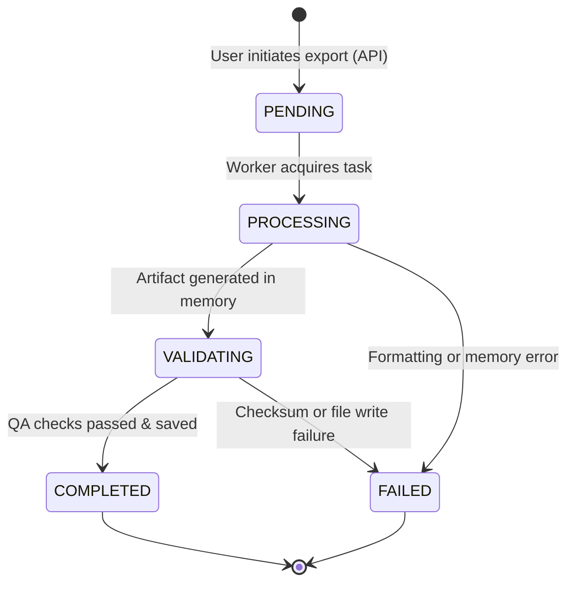

# ScholarForge AI — Technical Specification
## Export Job Management, Security & Private File Storage

**Document ID:** SPEC-DOC-SEC-008  
**Module:** `backend/research/export_job_service.py`  
**Classification:** Infrastructure, Asynchronous Jobs & Security  
**Status:** Approved & Implemented (Stage 8)  

---

### 1. Architectural Purpose & Overview

Document export involves memory-intensive formatting and binary compilation. The Export Job Management system provides:
1. Asynchronous job lifecycle processing with real-time status reporting.
2. Idempotent job dispatching preventing duplicate document exports on rapid double-clicks.
3. Protected private filesystem storage isolated from public static assets.
4. Strict multi-tenant object-level authorization on document downloads.

---

### 2. Asynchronous Job State Machine

Export tasks transition through a deterministic lifecycle:

#### Job Attributes (`ExportJob`):
- `id`: UUID primary key.
- `project`: Foreign key to `ResearchProject`.
- `status`: `PENDING` | `PROCESSING` | `VALIDATING` | `COMPLETED` | `FAILED`.
- `progress_pct`: Integer between `0` and `100`.
- `status_message`: Human-readable stage description (e.g. *"Generating OpenXML semantic styles..."*).
- `idempotency_key`: Client-supplied unique token preventing re-runs.
- `document_export`: Foreign key to completed `DocumentExport`.

---

### 3. Private File Storage Architecture

Exported manuscripts contain sensitive, unpublished research data, proprietary experiments, and embargoed findings.

#### Security Guarantees:
1. **Isolated Private Storage Directory**:
   - Files are stored in `<MEDIA_ROOT>/private/exports/<project_id>/<export_id>.<ext>`.
   - This directory is **strictly excluded** from web server static/media direct mapping (`nginx`, `whitenoise`, or dev server).
   - Direct URL pathing (e.g., `GET /static/exports/thesis.docx`) yields a `404 Not Found`.
2. **Streaming Binary Downloads**:
   - File retrieval is gated behind `DocumentExportDownloadView` (`/api/v1/research/exports/<id>/download/`).
   - The view enforces `IsProjectMemberOrOwner` permissions.
   - Files are delivered using `FileResponse(open(path, 'rb'))` with sanitized `Content-Disposition` attachment headers and exact MIME types (`application/vnd.openxmlformats-officedocument.wordprocessingml.document` and `application/pdf`).
3. **Audit Logging & Provenance**:
   - Every file download event logs the requesting user, timestamp, IP address, and validated SHA-256 hash.

---

### 4. Idempotency Key Specification

To prevent accidental resource exhaustion or redundant builds:
- Clients generate a client UUID (`idempotency_key`) sent in the export initiation payload.
- If a job with `idempotency_key` is already `PENDING` or `PROCESSING`, the existing job ID is returned without spawning a duplicate background task.
- If an existing export with the exact same document version, template, format, and citation style exists within 5 minutes, the existing artifact is returned.

---

### 5. Access Control Matrix

| Endpoint | Anonymous | Collaborator (Assigned) | Project Owner | Outside User |
|---|---|---|---|---|
| `POST /projects/{id}/export/` | 401 Unauthorized | 200 OK | 200 OK | 403 Forbidden |
| `GET /export-jobs/{id}/` | 401 Unauthorized | 200 OK | 200 OK | 403 Forbidden |
| `GET /exports/{id}/` | 401 Unauthorized | 200 OK | 200 OK | 403 Forbidden |
| `GET /exports/{id}/download/` | 401 Unauthorized | 200 OK | 200 OK | 403 Forbidden |
| `DELETE /exports/{id}/` | 401 Unauthorized | 403 Forbidden (Owner only) | 200 OK | 403 Forbidden |
| `POST /exports/{id}/validate/` | 401 Unauthorized | 200 OK | 200 OK | 403 Forbidden |

