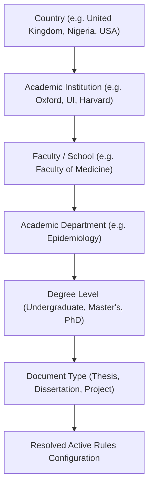

# Institutional & Departmental Template Engine Specification
**ScholarForge AI — Stage 7 Technical Specification**

---

## 1. Executive Summary

ScholarForge AI provides an authoritative, hierarchical institutional template engine designed to format and validate academic manuscripts across all academic disciplines, degree levels, and institutional traditions. 

To eliminate hallucination and maintain absolute academic integrity, the system implements strict verification rules: no template may claim `OFFICIALLY_VERIFIED` status without an authoritative institutional guideline source URL and recorded verification timestamp.

---

## 2. Institutional Hierarchy Architecture

Academic formatting rules are inherited and resolved hierarchically:

### Hierarchy Fallback Logic
When a manuscript requests formatting guidelines:
1. Exact Department + Degree Level match is searched.
2. If absent, Faculty-level rules for that Degree Level are resolved.
3. If absent, Institution-wide standard for that Degree Level is resolved.
4. If absent, General Disciplinary or National standard is applied.

---

## 3. Verification Status Rules

Every `FormattingTemplate` and `TemplateVersion` is governed by a deterministic verification state machine:

| Status | Code | Invariants & Requirements |
| :--- | :--- | :--- |
| **Officially Verified** | `OFFICIALLY_VERIFIED` | **Strict requirement**: Authoritative institution-issued guideline URL (`verification_source_url`) and verification date (`verification_date`) are mandatory. Cannot be saved without an authoritative HTTP(S) source. |
| **Community Verified** | `COMMUNITY_VERIFIED` | Maintained by academic user community with institutional cross-validation. |
| **User Customized** | `USER_CUSTOMIZED` | Created by a researcher via cloning or manual configuration. Default private to researcher's workspace. |
| **Draft** | `DRAFT` | Unverified extraction from uploaded handbook pending human validation. |
| **Archived** | `ARCHIVED` | Deprecated historical standard preserved for reproducibility of past defended theses. |

---

## 4. Pre-Seeded Authoritative Templates

ScholarForge AI ships with pre-verified authoritative standards:

1. **University of Oxford (DPhil Dissertation Standard)**
   - Binding Gutter: 0.5 inches (1.5 in left margin, 1.0 in top/bottom/right).
   - Typography: 12pt Times New Roman, double line spacing (2.0x).
   - Front Matter: Title Page, Abstract (max 300 words), Acknowledgements, Table of Contents.
   - Verification Source: Oxford Academic Regulations & Examination Decrees.

2. **University of Cambridge (PhD Thesis Standard)**
   - Paper Size: A4, 1.5 in left margin (binding allowance).
   - Typography: 12pt Times New Roman / Calibri, 1.5 to 2.0 line spacing.
   - Front Matter: Title Page, Declaration of Originality, Abstract, TOC.

3. **Harvard University (Doctoral Dissertation Guidelines)**
   - Left Margin: 1.5 in (binding); Right/Top/Bottom: 1.0 in.
   - Typography: 12pt Times New Roman, double line spacing.
   - Abstract: Maximum 350 words mandatory.

4. **Massachusetts Institute of Technology (MIT Specifications for Thesis Preparation)**
   - Margins: 1.25 in left, 1.0 in right/top/bottom.
   - Mandatory Title Page, Certificate of Approval, Biographical Sketch.

5. **University of Ibadan (Postgraduate College Thesis Regulations)**
   - Binding Gutter: 0.5 in (1.5 in left margin).
   - Preliminary Pages: Title Page, Certification, Declaration, Dedication, Acknowledgements, Abstract, Table of Contents, List of Tables, List of Figures.
   - Roman pagination for prelims, Arabic for main text.

6. **APA 7th Edition Academic Project Standard**
   - 1.0 in margins all sides, 0.5 in first-line paragraph indent.
   - Author-date in-text citations with 0.5 in hanging indent bibliography.

7. **IEEE Academic Paper & Thesis Standard**
   - Two-column or single-column layout, numeric bracketed citations `[1]`.
   - Table captions centered above table, Figure captions below figure.

---

## 5. REST API Endpoints

- `GET /api/v1/research/institutions/`: Filter institutions by country.
- `GET /api/v1/research/departments/`: Filter departments by faculty or institution.
- `GET /api/v1/research/templates/`: Query templates by institution, degree level, or document type.
- `POST /api/v1/research/templates/`: Create new template with verification validation.
- `POST /api/v1/research/templates/{id}/clone/`: One-click fork into user customized standard.
- `POST /api/v1/research/projects/{id}/template/`: Assign active formatting template to project.

