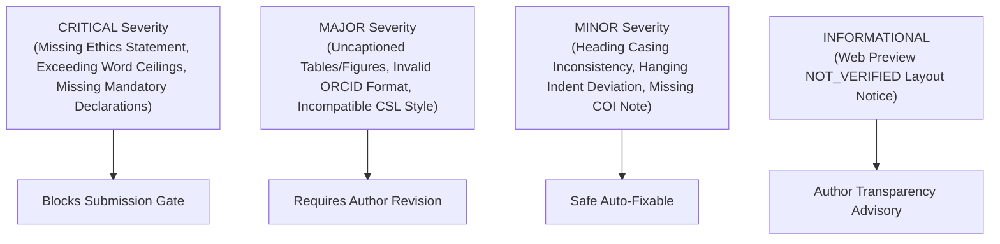

# Manuscript Compliance Intelligence Specification
**ScholarForge AI — Stage 7 Technical Specification**

---

## 1. Overview & Principles

The Manuscript Compliance Intelligence Engine is a deterministic auditing service that inspects research projects against institutional guidelines and journal publication constraints.

### Core Invariants:
1. **Deterministic Rule Evaluation**: All checks are deterministic code rules (regex, word counts, DOM introspection) rather than opaque LLM guesses.
2. **Transparent Layout Indicator**: Because HTML web preview cannot measure exact physical paper boundaries, physical pagination is explicitly designated `NOT_VERIFIED` in web preview and measured during PDF/DOCX rendering.
3. **Multi-Tier Severity Classification**: Issues are categorized into 4 actionable severity tiers:
   - `CRITICAL`: Blocks degree submission or causes immediate journal rejection.
   - `MAJOR`: Significant guideline non-compliance requiring remediation.
   - `MINOR`: Formatting inconsistency or stylistic deviation.
   - `INFORMATIONAL`: Helpful notes or transparency notices.

---

## 2. Issue Severity Tiers

---

## 3. Evaluated Rule Categories

1. **Page Settings (`PAGE_SETTINGS`)**:
   - Margins (top, bottom, left, right).
   - Binding gutter allowance (e.g. 0.5 in minimum for hardcover binding).
2. **Typography (`TYPOGRAPHY`)**:
   - Approved primary font families (Times New Roman, Arial, Calibri, Georgia).
   - Font sizes (12pt body text, 14pt chapter headings).
   - Line spacing standards (single, 1.5, double).
3. **Chapter Structure (`CHAPTER_STRUCTURE`)**:
   - Decimal Arabic heading numbering (`1.1`, `1.2.1`) vs. Roman.
   - Maximum heading depth ceilings.
4. **Pagination (`PAGINATION`)**:
   - Roman lowercase front matter pagination.
   - Arabic main body pagination beginning at Chapter 1.
5. **Preliminary Pages (`PRELIMINARY_PAGES`)**:
   - Mandatory existence of Title Page, Certification, Declaration, and Abstract.
6. **Tables & Figures (`TABLES_FIGURES`)**:
   - Captions placed above tables, captions placed below figures.
   - Numbering scheme (sequential vs. chapter-based).
7. **Citations & References (`CITATIONS_REFERENCES`)**:
   - Conformity to active citation style.
   - Mandatory DOI resolution for modern references.
8. **Word Limits (`WORD_LIMITS`)**:
   - Abstract minimum/maximum word counts (e.g. 150–350 words).
   - Total manuscript word ceiling.
9. **Metadata & Declarations (`METADATA`)**:
   - Verified ORCID formats (`^\d{4}-\d{4}-\d{4}-\d{3}[\dX]$`).
   - Ethics approval statement for empirical research.
   - Data availability and conflict of interest declarations.

