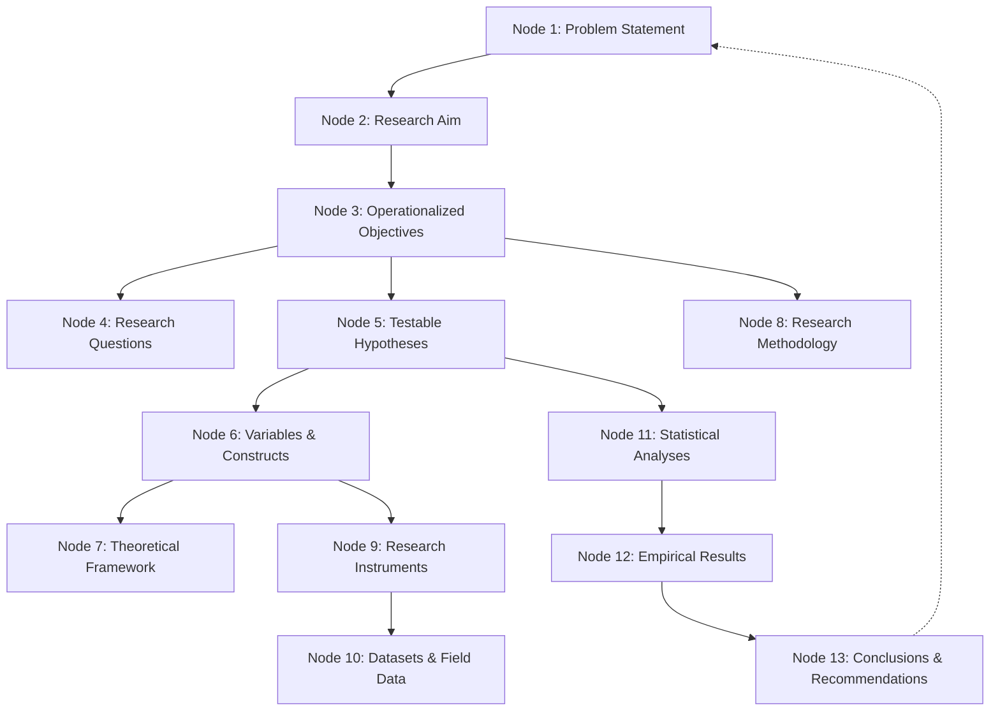

# 13-Node Research Alignment Matrix Specification
**ScholarForge AI — Graph-Based Coherence Verification Architecture**

## 1. Overview & Concept
The 13-Node Research Alignment Matrix validates the logical, methodological, and empirical congruence across the entire research lifecycle. Academic research fails when downstream sections diverge from upstream propositions (e.g., measuring variables that do not appear in research questions, or testing hypotheses that lack empirical instruments).

---

## 2. The 13 Coherence Nodes

### Detailed Node Definitions
1. **`PROBLEM_STATEMENT`**: The empirical discrepancy, knowledge void, or practical challenge under inquiry.
2. **`RESEARCH_AIM`**: Overarching purpose statement addressing the core gap.
3. **`OBJECTIVES`**: Specific, operationalized milestones required to achieve the research aim.
4. **`RESEARCH_QUESTIONS`**: Inquiries formulated to guide qualitative or exploratory facets of the investigation.
5. **`HYPOTHESES`**: Null ($H_0$) and alternative ($H_1$) propositions stating expected statistical relationships.
6. **`VARIABLES`**: Explicitly identified independent, dependent, moderating, or mediating constructs.
7. **`THEORETICAL_FRAMEWORK`**: Grounding theories, conceptual models, and paradigm orientations.
8. **`METHODOLOGY`**: Selected disciplinary research design, sampling frame, and analytical strategy.
9. **`INSTRUMENTS`**: Measurement scales, survey items, interview guides, or observation protocols.
10. **`DATASETS`**: Real collected observations, panel series, or transcribed interview texts.
11. **`STATISTICAL_TESTS`**: Executed statistical procedures (e.g., independent t-tests, multiple regression, ANOVA).
12. **`RESULTS`**: Real calculated numerical findings, effect sizes, p-values, or thematic code tables.
13. **`CONCLUSIONS`**: Inferences, practical implications, and answering of original research questions.

---

## 3. Congruence Index & Issue Generation

The Congruence Index ($0 \le C \le 100$) evaluates connection completeness:

$$C = 100 \times \left(1 - \frac{w_{\text{crit}} N_{\text{crit}} + w_{\text{warn}} N_{\text{warn}}}{M_{\text{max\_penalty}}}\right)$$

- **Orphaned Instrument Detection**: An instrument item is flagged if its underlying variable does not map to any active research objective.
- **Untested Hypothesis Detection**: Hypotheses marked as active without linked statistical results generate critical alignment issues.
- **Ungrounded Conclusion Detection**: Conclusions asserting statistical effects without corresponding statistical model output trigger critical warnings.

