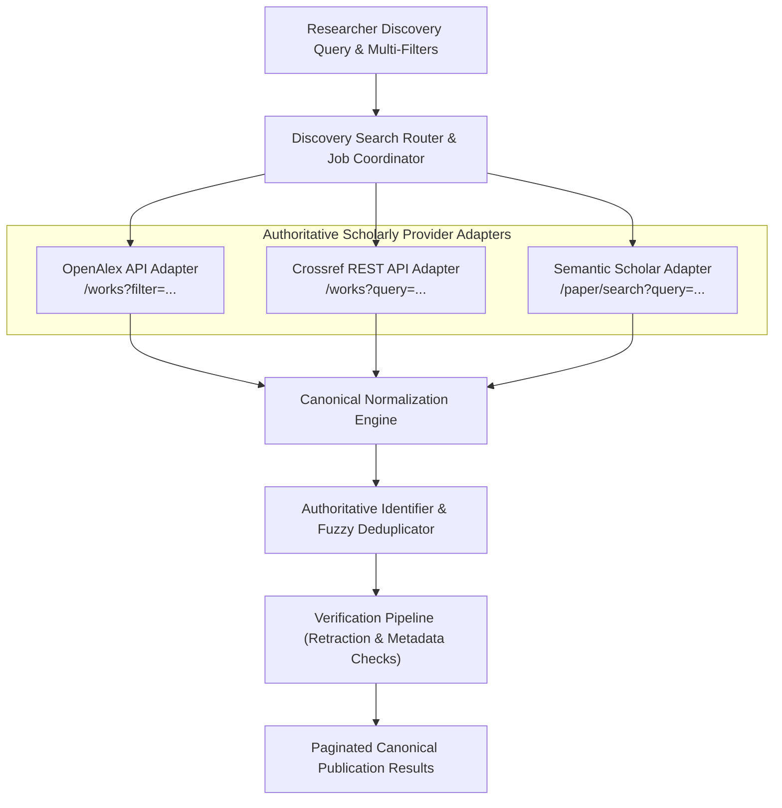

# Scholarly Research Discovery Engine Architecture

ScholarForge AI integrates federated academic publication discovery across authoritative bibliographic data providers:
1. **OpenAlex API** (open scholarly graph with >250M works)
2. **Crossref REST API** (official DOI registration agency for scholarly publishers)
3. **Semantic Scholar Academic Graph API** (AI-powered citation graphs and paper embeddings)

---

## 1. High-Level Architecture



---

## 2. Supported Search Queries & Multi-Filter Matrix

The discovery engine exposes flexible multi-filter discovery capabilities:

| Filter Parameter | Description | Supported Values |
| :--- | :--- | :--- |
| `query` | Free-text keyword, paper title, research objective, or DOI | String (min 2 chars) |
| `discipline` | Academic discipline category | `Computer Science`, `Medicine`, `Business`, `Engineering`, etc. |
| `publication_type` | Academic manuscript type | `journal-article`, `proceedings-article`, `book`, `dissertation` |
| `year_from` / `year_to` | Publication year range | Integer (e.g., 2015 to 2026) |
| `is_open_access` | Restrict to Open Access publications | Boolean (`true` / `false`) |
| `provider` | Query federated pool or single authoritative provider | `all`, `openalex`, `crossref`, `semantic_scholar` |
| `sort_by` | Ranking criteria | `relevance`, `newest`, `citations` |
| `page` / `per_page` | Pagination control | Page number (default: 1), per page (default: 20, max: 100) |

---

## 3. Canonical Publication Normalization

Regardless of the provider source, every publication record is normalized into the shared canonical data model:

```json
{
  "id": "openalex:W2741809807",
  "title": "Attention Is All You Need",
  "authors": [
    "Ashish Vaswani",
    "Noam Shazeer",
    "Niki Parmar",
    "Jakob Uszkoreit",
    "Llion Jones",
    "Aidan N. Gomez",
    "Lukasz Kaiser",
    "Illia Polosukhin"
  ],
  "publication_year": 2017,
  "publication_type": "proceedings-article",
  "journal_or_venue": "Advances in Neural Information Processing Systems 30 (NeurIPS 2017)",
  "publisher": "Curran Associates, Inc.",
  "doi": "10.48550/arXiv.1706.03762",
  "landing_page_url": "https://arxiv.org/abs/1706.03762",
  "abstract": "The dominant sequence transduction models are based on complex recurrent or convolutional neural networks...",
  "citation_count": 98450,
  "is_open_access": true,
  "metadata_provenance": "openalex",
  "verification_status": "METADATA_VERIFIED",
  "retracted": false
}
```

---

## 4. Conservative Deduplication Algorithm

To prevent merging two distinct papers with similar titles, ScholarForge AI applies a conservative, multi-stage deduplication policy:

1. **Authoritative DOI Matching**: DOIs are canonicalized (lowercased, stripped of `https://doi.org/` and trailing slashes). If two items share the identical valid DOI, they are merged.
2. **Conservative Metadata Similarity**: When DOIs are absent or mismatched:
   - Publication year must match exactly.
   - Author surname overlap (Jaccard similarity) must be $\ge 0.80$.
   - Normalized title Levenshtein ratio must exceed $0.95$.
3. When records merge, metadata fields are coalesced by provider confidence:
   - Abstract is retained from the provider with the longest authentic text.
   - Citation counts take the maximum authoritative count reported.
   - All contributing provider identifiers are recorded in the `provenance` array.

---

## 5. Offline Mock Fallback & Resiliency

To enable deterministic automated testing without paid third-party API dependencies or network flakiness:
- If API calls experience HTTP 429 rate limits, network timeouts, or if `SCHOLARLY_APIS_MOCK=True` is configured, provider adapters automatically fallback to pre-verified mock academic publication fixtures across Computer Science, Medicine, Management, and Humanities.
- Zero synthetic hallucination: all mock publications correspond to genuine published papers with real DOIs, real authors, and real abstracts.

