# Research Workflow Engine Specification
**ScholarForge AI — Adaptive Academic Lifecycle Architecture**

## 1. Overview & Purpose
The ScholarForge AI Research Workflow Engine coordinates the end-to-end academic research process across disciplines and document categories. Rather than imposing a rigid 5-chapter structure, the engine configures an adaptive lifecycle reflecting the methodological demands of empirical quantitative, qualitative, mixed-methods, theoretical/conceptual, legal, and systematic review inquiries.

---

## 2. Dynamic Lifecycle Stages

The system supports up to 12 lifecycle stages:

```mermaid
flowchart LR
    S1[1. Setup] --> S2[2. Planning]
    S2 --> S3[3. Discovery]
    S3 --> S4[4. Framework]
    S4 --> S5[5. Methodology]
    S5 --> S6[6. Instruments]
    S6 --> S7[7. Sampling]
    S7 --> S8[8. Analysis]
    S8 --> S9[9. Interpretation]
    S9 --> S10[10. Manuscript]
    S10 --> S11[11. Quality Audit]
    S11 --> S12[12. Review & Defense]
```

### Stage Customization by Category
| Stage Name | Empirical Quant | Empirical Qual | Mixed Methods | Theoretical | Systematic Review |
|---|---|---|---|---|---|
| **1. Research Setup** | Active | Active | Active | Active | Active |
| **2. Research Planning** | Active | Active | Active | Active | Active |
| **3. Literature Discovery** | Active | Active | Active | Active | Active (PRISMA) |
| **4. Framework Development** | Active | Active | Active | Active | Active |
| **5. Methodology Design** | Active | Active | Active | Active | Active |
| **6. Instrument Design** | Active | Active | Active | — | — |
| **7. Sampling & Collection** | Active | Active | Active | — | — |
| **8. Data Analysis** | Statistical | Thematic | Statistical+Thematic | Deductive | Synthesis |
| **9. Results Interpretation** | Active | Active | Active | Conceptual | Active |
| **10. Manuscript Drafting** | Active | Active | Active | Active | Active |
| **11. Quality Audit** | Active | Active | Active | Active | Active |
| **12. Defense & Review** | Active | Active | Active | Active | Active |

---

## 3. Real Progress Calculation Algorithm

Progress is never simulated or hardcoded. `WorkflowService.calculate_project_progress` aggregates the completion state of verified database records:

$$\text{Progress}_{\text{Stage}} = \frac{1}{|\text{Steps}|} \sum_{i=1}^{|\text{Steps}|} \text{EvaluateEntity}(step_i)$$

$$\text{Total Completion} = \frac{1}{|\text{Stages}|} \sum_{j=1}^{|\text{Stages}|} \text{Progress}_{\text{Stage}_j} \times 100\%$$

- **Setup**: Verified by `ResearchProject` title confirmation and metadata population.
- **Planning**: Verified by `ResearchDecision.is_approved` and non-empty objectives.
- **Literature**: Verified by `ProjectSource` count ($\ge 3$ verified sources).
- **Methodology**: Verified by `ResearchMethodology` model instance existence.
- **Analysis**: Verified by `StatisticalResult` or `QualitativeTheme` counts.
- **Manuscript**: Evaluates drafted word count against target word count across all `DocumentSection` instances.
- **Quality Audit**: Verified by executed `ManuscriptValidation` instance.
- **Defense & Review**: Verified by registered `ReviewRecord` checkpoints.

