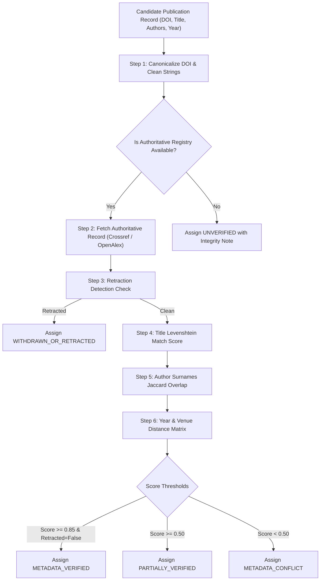

# Publication Verification Engine Specification

ScholarForge AI features an evidence-grounded verification engine that inspects discovered, imported, or manually added research publications to guarantee citation authenticity and protect against retracted literature.

---

## 1. Verification Status Taxonomy

Every publication is assigned an evidence-based verification status:

| Status | Description | Actionable Guidance |
| :--- | :--- | :--- |
| `METADATA_VERIFIED` | Title, author list, publication year, and journal/publisher confirmed against authoritative Crossref/OpenAlex records with high confidence ($\ge 0.90$). | Safe for direct citation and literature synthesis. |
| `PARTIALLY_VERIFIED` | Publication exists in authoritative registries, but minor metadata discrepancies exist (e.g., author spelling variations or publication year shifts between preprint and final edition). | Flagged for researcher review. Allowed in bibliography. |
| `UNVERIFIED` | Preprints, institutional seminar working papers, historical manuscripts, or legal documents lacking DOI/registry entries. | Allowed for humanities, legal statutes, and archival research with provenance warning. |
| `METADATA_CONFLICT` | Severe discrepancy between imported metadata and authoritative records (e.g. matching DOI but completely different authors or disparate venue). | Flagged with high warning badge. Excluded from automated synthesis until resolved. |
| `WITHDRAWN_OR_RETRACTED` | Official retraction notice detected in Crossmark, Crossref metadata, or OpenAlex retraction index. | **CRITICAL INTEGRITY ALERT**. Blocked from citation without explicit warning override. |

---

## 2. Multi-Step Verification Pipeline

---

## 3. String & Author Distance Formulations

### Title Normalized Similarity
Titles are stripped of punctuation, lowercased, and compared using the Levenshtein sequence matching ratio:
$$R_{\text{title}} = \frac{2 \cdot M}{T_1 + T_2}$$
Where $M$ is the number of matching characters, and $T_1, T_2$ are the lengths of the titles.

### Author Surnames Overlap
Surnames are extracted and tokenized into sets $A_{\text{source}}$ and $A_{\text{registry}}$:
$$J_{\text{authors}} = \frac{|A_{\text{source}} \cap A_{\text{registry}}|}{|A_{\text{source}} \cup A_{\text{registry}}|}$$

### Total Verification Confidence Score
$$\text{Confidence} = 0.50 \cdot R_{\text{title}} + 0.30 \cdot J_{\text{authors}} + 0.20 \cdot \mathbb{I}(\text{year matches})$$

- $\text{Confidence} \ge 0.85 \implies \text{METADATA\_VERIFIED}$
- $0.50 \le \text{Confidence} < 0.85 \implies \text{PARTIALLY\_VERIFIED}$
- $\text{Confidence} < 0.50 \implies \text{METADATA\_CONFLICT}$

---

## 4. Retraction Checking Mechanism
1. **Crossref Crossmark**: Inspects Crossref metadata for `update-to` entries with `type: "retraction"`, `"withdrawal"`, or `"expression_of_concern"`.
2. **OpenAlex Retraction Graph**: Queries OpenAlex works API for `is_retracted: true` and retraction notice DOIs.
3. When detected, the `retracted` boolean flag is set to `True`, `verification_status` is updated to `WITHDRAWN_OR_RETRACTED`, and detailed retraction metadata is persisted in `retraction_details`.

